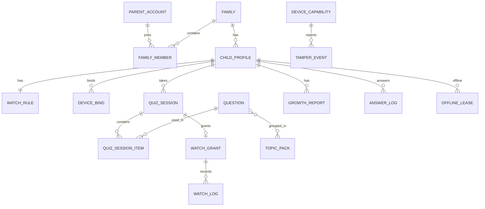

# 数据模型说明

> 对应设计：[001-项目总体设计方案](design/001-项目总体设计方案.md) 第 6 节
> 实现：`migrations/00001_init.sql`、`migrations/00002_seed_tags.sql`
> 最后更新：2026-11-02

## 1. 设计原则

1. **单题库**：只有 `question` 一张题目主表，学科/类目/学段/题型都是标签。
2. **标签字典化**：`tag_dict` 是取值的唯一来源，新增学科/题型只插数据。
3. **答案不出服务端**：`answer` / `answer_alias` 仅服务端可见；会话中另存答案快照用于稳定判分。
4. **服务端裁决**：规则、判分、授权、额度全部落库留痕。
5. **JSON 带版本**：`schema_ver` 描述结构版本，`version` 描述内容修订。

## 2. 实体关系



## 3. 表分组

| 分组 | 表 | 说明 |
| --- | --- | --- |
| 字典 | `tag_dict` | 学科/类目/学段/年级/难度/题型 |
| 题库 | `question`、`topic_pack`、`topic_question`、`media_asset` | 单表题库 + 题包关联 |
| 身份 | `parent_account`、`parent_session`、`family`、`family_member`、`family_invite`、`child_profile` | 家长、登录会话、家庭组、邀请、孩子档案 |
| 设备 | `device_bind`、`device_capability`、`tamper_event` | 绑定、能力/权限、异常上报 |
| 规则 | `watch_rule` | 每孩子一条，带版本 |
| 答题 | `quiz_session`、`quiz_session_item`、`answer_log` | 会话（规则快照/得分）、题目快照、答题记录 |
| 授权 | `watch_grant`、`watch_log`、`offline_lease` | 使用授权、应用使用、离线租约 |
| 报告 | `growth_report`、`coverage_snapshot` | 周/月聚合、覆盖率日快照 |
| 治理 | `admin_user`、`admin_role`、`admin_permission`、`admin_user_role`、`admin_role_permission`、`audit_log` | RBAC 与审计 |

## 4. 关键约束

| 约束 | 实现 |
| --- | --- |
| 学段只能是四档 | `question.stage_code` / `child_profile.stage_code` CHECK |
| 趣味题必须有近义答案 | `category_code='fun'` 时 `answer_alias` 数组非空 |
| 一台设备同时只绑一个孩子 | `device_bind (device_id) WHERE status='active'` 部分唯一索引 |
| 一个孩子一条规则 | `watch_rule.child_id` UNIQUE |
| 一次会话只能签发一次授权 | `watch_grant.session_id` UNIQUE |
| 一次会话内题目不重复 | `quiz_session_item (session_id, question_id)` UNIQUE |
| 答题令牌一次性 | `quiz_session_item.answer_token_jti` UNIQUE |
| 暂停时长不计额度 | `watch_log.paused_seconds` 单列，结算时排除 |
| 手机号可查不可逆 | `phone_cipher`（AES-GCM）+ `phone_hash`（HMAC）唯一索引 |
| 刷新令牌轮换 | `parent_session.token_hash` UNIQUE；刷新时旧令牌立即吊销 |
| 邀请码一次性 | `family_invite` 未使用邀请码部分唯一索引 |
| 一个账号一个生效家庭 | `parent_account.active_family_id`，加入新家庭后切换 |

## 5. 迁移

```bash
make migrate-up       # 应用全部迁移
make migrate-down     # 回滚一个迁移
make migrate-status   # 查看状态
```

- 迁移内嵌在 `cmd/migrate` 二进制中，部署时无需额外文件。
- `00002_seed_tags.sql` 可重复执行（`ON CONFLICT DO UPDATE`），回滚不删除标签。
- 生产迁移仅向前；`down` 用于开发与预发演练。

## 6. 已知取舍

| 项 | 当前实现 | 后续 |
| --- | --- | --- |
| 日志表分区 | `answer_log` / `watch_log` 首期普通表 + 索引 | 数据量达标后按 `answered_at` / `start_at` 月分区迁移 |
| sqlc | 暂未引入，T3 起用 pgx 手写 SQL | 查询稳定后评估 sqlc 生成 |
| 手机号加密 | 字段与索引已就绪，加解密在应用层 | T3 实现 KMS/本地密钥与迁移工具 |
| 软删除 | 未引入 `deleted_at` | 以状态字段为主；确需软删时统一加列 |
